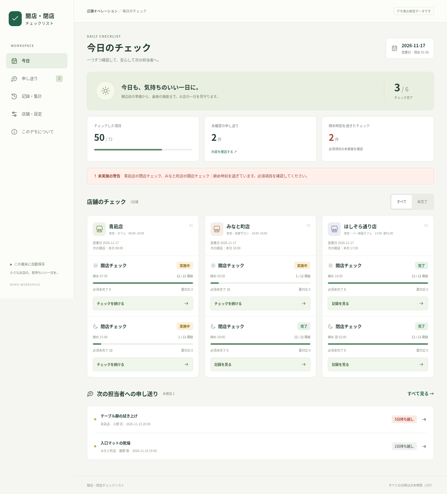

# 開店・閉店チェックリスト

## 概要

サロン・カフェ・小売など、1〜3店舗の小さなお店向けの開店前・閉店後チェックアプリです。
スマートフォンで毎日の定型チェックを進め、担当者と日本時間の確認時刻を記録します。
終わらなかったことや気づきを次の担当者へ申し送り、受け取り確認までつなぎます。
デモ用の架空データです。

## 主な機能

### 1. 開店・閉店の定型チェック

- 店舗ごとの開店・閉店テンプレート。カテゴリ、順序、必須・任意、曜日を設定。
- 確認・数値・選択の3種類。数値の基準範囲外や選択の異常結果を警告。
- 大きなOKボタン、要対応コメント、1項目2枚までの写真添付。
- 完了数・要対応数・必須未完了数を表示。写真は長辺1200px以下に縮小。

### 2. 担当者と時刻の記録・未実施の警告

- 店舗別スタッフから担当者を選び、途中交代も日時付きで記録。
- 締め時刻を過ぎて必須項目が残ると、ホームの店舗一覧上部に未実施警告。
- 必須項目がすべて確認済み、または申し送り済みの場合に完了可能。
  未確認の受け取り対象申し送りがある場合も完了を制限。
- 担当者とひとことを残して完了すると項目をロック。申し送り状態のみ更新可能。
- 店舗・種類・期間・担当者・要対応ありで記録を検索。
- 店舗別・開店閉店別の実施率と平均完了時刻、項目別の要対応回数。
- BOM付きCSVの期間・1回分ダウンロードと、1回分の印刷表示。

### 3. 未完了項目の申し送り

- 項目に紐づく申し送りと自由記述。宛先は次の開店・次の閉店・店長。
- 未確認 → 確認済み → 対応済みの状態遷移。確認者・対応者・日時を記録。
- 店舗・宛先・状態で絞り込み。3日以上の持ち越しを強調。
- 宛先のチェックの実施可能時刻以前に作成された、同店舗の申し送りを表示。
  自分のチェックから作成したものはそのチェックの受け取り対象から除外します。

## 営業日と時刻のルール

- 日本時間の `YYYY-MM-DD` と `HH:MM` を使用します。現在時刻はクライアントのマウント後に決定。
- 既定の切り替えは05:00。00:00〜04:59は前日の営業日です。店舗ごとに変更できます。
- 閉店時刻が開店時刻以前、または切り替え時刻より前の場合は翌日の時刻です。
  例：17:00〜翌01:00の店舗で01:20に開くと、前営業日の閉店チェックが表示されます。
- 開店・閉店の何分前から実施可能かを設定。開始前は未着手（予定）として表示し、操作を制限。
- 開店の締めは既定で10分前、閉店の締めは60分後。店舗ごとに変更可能。
- 15秒ごとに現在時刻と営業日を確認し、新しい営業日のチェックを必要に応じて生成。
- テンプレートと営業時間の変更は次に生成されるチェックから適用。既存記録は保持。
- 実施率は「完了したチェック ÷ 実施可能になったチェック」。予定は分母から除外。
  平均完了時刻は深夜を翌日として計算し、開店・閉店別に表示します。

## 既存作品との違い

| 既存作品               | 本作で扱わないこと                     | 本作の焦点                   |
| ---------------------- | -------------------------------------- | ---------------------------- |
| 保守・点検管理システム | 周期点検計画、修理管理、保全KPI        | 毎日の定型チェック           |
| 設備・備品管理システム | 設備台帳、設備履歴、在庫数             | 開閉店時の確認結果           |
| 納品・検収チェック     | 納品明細の照合、検収サイン             | 店舗の開閉店作業             |
| 期限ノート             | 法定点検・資格・保険の期限、リマインド | 当日の締め時刻と未実施警告   |
| 売上管理システム       | レジ締めの金額計算、売上、釣銭金額     | レジを点検したか、差異の有無 |
| シフト管理システム     | シフト作成、勤怠打刻、予約             | 担当者を名前で選ぶこと       |

## 画面一覧

| パス            | 画面                                               |
| --------------- | -------------------------------------------------- |
| `/`             | 今日の店舗別チェック、未実施警告、未確認の申し送り |
| `/check/[id]`   | 担当者選択、申し送り確認、項目の実施、完了         |
| `/handover`     | 申し送りの追加・絞り込み・受け取り・対応済み更新   |
| `/history`      | 記録検索、集計、期間CSV                            |
| `/history/[id]` | 1回分の記録、担当交代履歴、写真、印刷・CSV         |
| `/templates`    | 店舗・営業時間・スタッフ・テンプレート設定         |
| `/about`        | 保存先、デモの説明、写真削除、既定データへの復元   |

存在しないチェック・記録IDには「見つかりません」と表示します。
デスクトップではサイドバー、スマートフォンでは下部タブバーで移動します。

## データの保存先とPWA

チェック・店舗・設定・申し送りは **localStorage `occ:v1`**、写真は
**IndexedDB `occ-photos`** の `photos` ストアに保存します。
保存データの形や日時などを検証し、壊れたデータは通知して既定データに復元します。
認証、外部API、外部DB、メール・プッシュ通知、端末間同期は使いません。
ブラウザの保存領域を消すとデータは失われるため、必要な記録はCSVや印刷で保存してください。

本番環境でのみ `public/sw.js` を登録します。同一オリジンの画面とアセットをキャッシュし、
更新時に古いアプリキャッシュを削除します。オフライン時は画面上部に状態を表示します。
一度も開いていない画面や未取得のアセットはオフラインで利用できない場合があります。
未キャッシュの画面に直接アクセスした場合にはオフライン案内を表示します。
対応ブラウザのメニューからホーム画面へ追加できます。PWAにはHTTPSまたはlocalhostが必要です。

## 技術スタック

- Next.js 16 / App Router
- React 19 / TypeScript
- Tailwind CSS 4 とコンポーネント別CSS
- ESLint / Node.js標準テストランナー
- localStorage / IndexedDB / Service Worker / Web App Manifest
- 外部Webフォントや追加のランタイムパッケージは不使用

営業日・チェック判定・申し送り・集計・シード・CSV・保存データ検証は
`src/lib/` の純粋関数として分離しています。ブラウザI/Oは保存・写真・ダウンロード処理に限定します。

## 公開URL

[開店・閉店チェックリスト](https://store-open-close-checklist.vercel.app)

## スクリーンショット



02（チェックの実施）と03（申し送り）はスマートフォン表示（390×844）、01・04・05はPC表示（1440幅）です。

| 画面           | 画像                                                  |
| -------------- | ----------------------------------------------------- |
| 今日           | [01-today.png](docs/screenshots/01-today.png)         |
| チェックの実施 | [02-check.png](docs/screenshots/02-check.png)         |
| 申し送り       | [03-handover.png](docs/screenshots/03-handover.png)   |
| 記録・集計     | [04-history.png](docs/screenshots/04-history.png)     |
| 店舗・設定     | [05-templates.png](docs/screenshots/05-templates.png) |

## ローカル起動方法

Node.js 24以上を使用してください。テストはNode.jsのTypeScript型除去機能を使用します。
コマンドはこのリポジトリの直下で実行します。

```bash
npm install
npm run dev
```

ブラウザで [localhost:3000](http://localhost:3000) を開きます。

```bash
npm run lint
npm run typecheck
npm test
npm run build
npm start
```

本番ビルドでPWAとオフライン動作を確認できます。
`next.config.ts` の `turbopack.root: process.cwd()` はこのプロジェクト直下をルートに固定する設定です。

## デモデータについて

青凪店（架空・カフェ）、みなと町店（架空・美容サロン）、ほしぞら通り店
（架空・バー併設カフェ）の3店舗、各3〜4名のスタッフを収録しています。
店舗ごとの開店・閉店テンプレートは、それぞれの業態に合わせた13項目で、
数値・選択・月曜限定の清掃を含みます。

過去14営業日分と当日のチェック、6件の申し送りを用意しています。
日時は開いた日時からの相対で生成し、実績時刻は現在より前になります。
実施開始時刻前のチェックは完了・実施中にしません。
要対応、担当交代、締め超過、3日以上の持ち越し、確認済み・対応済みの申し送りも含みます。
写真はアプリ内で描いた架空のイラストで、「サンプル画像（架空）」と明記しています。
すべて架空であり、実在の店舗・企業・個人とは無関係です。

「このデモについて」の「既定データに戻す」で、その時点の日本時間を基準に再生成できます。
